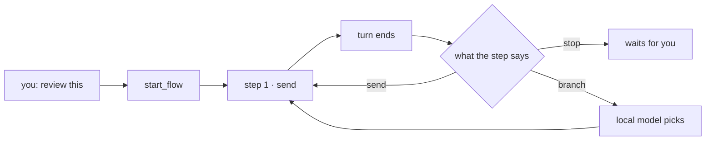

# dsh-agent-pipeline

<p align="center">
  <a href="https://img.shields.io/badge/DSH-Plugin-8b5cf6"></a>
  <a href="https://github.com/elias-didoo/dsh-agent-pipeline/blob/main/LICENSE"></a>
  <a href="https://nodejs.org"></a>
</p>

<p align="center">
  <a href="README.md"><b>English</b></a> •
  <a href="README.zh-CN.md"><b>中文说明</b></a>
</p>

## The problem

After every review step the agent stops. You read the diff, you type "continue",
it does the next thing. Multiply that by twelve steps per change and the review
is mostly you typing "continue".

This plugin makes the process the thing that runs. You write the steps down once
in the profile config — what to prompt, where to pause, which answers lead where
— and from then on the next prompt fires the moment the agent finishes the last
one. It stops only where you said it should stop, and it asks a local model only
where the pipeline genuinely forks.

**It does not think for you.** You decide the process; it walks it.



## Requirements

- **DSH Desktop** — the plugin needs the client runtime shipped inside `app.asar`.
- **A decision model server speaking `/v1/systemone`.** Built against the [llama.cpp server](https://github.com/ggerganov/llama.cpp) `systemone` interface; verified with a 4B decision model (Kev-4B).
  - Only `choice`, `score` and `noul` question types are used.
  - **No text generation capability is required.**
- The server must be reachable locally; default is `http://127.0.0.1:8080`.

## Install

Download the tarball from the [latest release](https://github.com/elias-didoo/dsh-agent-pipeline/releases/latest),
then install it the way any DSH plugin is installed — **Plugins → Add plugin**
with the path, or:

```json
{ "action": "install_bundle", "target": "/absolute/path/to/dsh-agent-pipeline-0.1.0.tgz" }
```

From source instead:

```bash
git clone https://github.com/elias-didoo/dsh-agent-pipeline.git
cd dsh-agent-pipeline && npm test        # optional, verifies your environment
```

...and point **Plugins → Add plugin** at that directory.

Then give the row its config in `~/.dsh/profiles/desktop/cordis.patch.yml`. A
patch that names an existing row by `id` and carries no `insert` **replaces**
that row's config; the bundle keeps providing the row itself:

```yaml
- id: agent-pipeline
  name: "dsh-agent-pipeline"
  config:
    # full example under "Configuring a flow"
```

Do not write `- insert:` for this plugin. The bundle already inserts the row, and
a second insertion under the same id is rejected — and a plugin mounted only by
hand is not an installed bundle, so it never appears in the plugin list.

**Restart DSH.** The panel and the workspace menu only appear after a restart:
a reload replaces the host half, not the browser's module generation.

## How it works

```
you say what you want → agent calls start_flow("requirement")
                          ↓
        the plugin walks a fixed step list, one step per turn
                          ↓
     ┌────────────────┬────────────────┬────────────────┬─────────────┐
   send            stop             wait-user          branch
 a prompt      pause for you     wait for a phrase   ask the model
```

**Why the split.** A workspace's process is fixed — the steps, their order and
their wording are things you decided once. Walking that process belongs in
code: it is deterministic, it costs nothing, and it cannot drift. What belongs
to the model is the one place the process genuinely forks, such as "does this
self-check still have problems to fix, or is it clean?".

Measured on the shipped configuration, that took the model from being asked on
every turn with twelve options to being asked once per pipeline with two.

**Flows are built from shared steps.** Three pipelines share most of their
steps; only the opening differs. Steps are defined once in a table and referenced
by id, so changing a prompt is one edit rather than three that can drift apart.

## Configuring a flow

Edit this plugin's `config` inside `~/.dsh/profiles/desktop/cordis.patch.yml`:

```yaml
workspaces:
  - path: /Users/you/project
    enabled: true
    steps:
      - id: review
        label: { en: Plan review, zh: 方案评审 }
        do: send
        prompt: Read the docs and code you actually need. Double-check whether…

      - id: confirm
        label: { en: Wait for go-ahead, zh: 等你决定开干 }
        do: stop
        notifyText: Plan is ready — your call whether to start.

      - id: start_work
        label: { en: User says go, zh: 用户说开干 }
        do: wait-user
        prompt: Say "go" when you want me to start checking.
        expect: go

      - id: selfcheck_branch
        label: { en: Any problems left?, zh: 还有问题吗 }
        do: branch
        question: Does the agent say problems remain, or that the check passed?
        options:
          problems: selfcheck_3
          clean: push

      - id: selfcheck_3
        do: send
        prompt: Every self-check finds something new. Do you need another round?

      - id: push
        do: send
        prompt: Push it.

    flows:
      - name: requirement
        label: { en: Requirement, zh: 需求流程 }
        steps: [review, confirm, start_work, selfcheck_branch, selfcheck_3, push]
```

`fixtures/brandu.yml` holds the full working set this plugin was built against
— twelve steps and three flows covering requirement, bug and conflict handling.

## Anatomy of a step

A step is one thing the plugin does when the flow reaches it.

| Field | Required | Meaning |
|---|---|---|
| `id` | yes | Stable name. Also the tag on the message it sends. |
| `do` | yes | `send`, `stop`, `wait-user` or `branch`. |
| `label` | no | `{ en, zh }` shown in the panel. Falls back to the first line of prose. |
| `prompt` | `send`, `wait-user` | The message text. For `wait-user`, what tells the user what to say. |
| `notifyText` | no | Panel text explaining what a `stop` means. |
| `expect` | no | `wait-user` only: the phrase the user must say. Empty accepts any message. |
| `question` + `options` | `branch` | A two-way question and the step id each answer leads to. |

### What each kind does

**`send`** posts its prompt and advances. No model involved, which is the
common case.

**`stop`** advances and then holds: the plugin goes quiet until the user speaks.
Use it where you want to look at the plan before work starts.

**`wait-user`** advances only when the newest human message contains `expect`
and was written after the flow arrived here. That second condition is what stops
an old "go" from satisfying every later wait. It is not the same as `stop`: a
`stop` resumes on any reply, a `wait-user` resumes only on the phrase.

**`branch`** asks the model a two-way question and jumps to the chosen step.
Every step the branch skipped stays pending, so the panel shows what was not
done rather than claiming it was.

### Flow rules the validator enforces

- Every step a flow lists must exist in the shared table.
- A flow may not list the same step twice — the log records that a prompt was
  sent, not which visit sent it, so a repeat makes progress unrecoverable.
- A branch has exactly two options, and both must point inside the same flow.
- A flow needs at least one `stop` or `wait-user`, or it would run to the end
  without ever pausing for you.

Configuration is validated at load. A broken reference fails loudly instead of
running until it reaches the bad step and stopping in a state nobody planned.

## Reading the flows

Right-click a workspace and pick **Agent flows…**. A read-only panel lists every
flow with its steps, each step's full prompt, and where each branch leads — plus
whether the plugin is on for that workspace.

It is read-only on purpose: the config is the single source of truth, and the
panel's footer says which file to edit.

## Starting a flow

Two ways in, one implementation.

**`/flow`** — type it yourself, the same way `/goal` works:

```
/flow requirement        start that one
/flow pause|resume|cancel  steer the running one
```

`/flow` starts and steers; it does not print the rules. A command that declares
an argument is always intercepted for one, so a bare `/flow` never reaches the
handler — reading them is the menu's job.

**`start_flow`** — the agent calls it, the same mechanism as `create_goal` or
`todo_write`. You ask in words; the agent turns that into the call:

```
you: 评估如下需求，仅评估，不要动仓库：xxx
agent → start_flow({ flow: "requirement" })
```

Both routes call the same host method, so they cannot diverge.

Starting and pausing are separated on purpose: starting is offered to both
callers, but pause, resume and cancel are user-only. An agent that could park
its own pipeline could also quietly skip its self-check.

## Language

Two different languages are in play, and they follow different rules.

| What | Follows |
|---|---|
| Panel text, `/flow` replies, and the "please continue" prompt sent to the agent | **Your DSH language setting** |
| What the decision model is asked at a branch | **Whatever you wrote in that step's `question`** |

The panel reads the language from DSH settings, so it matches the rest of the UI
without extra configuration. If you have never explicitly picked a language in
DSH, the plugin falls back to English.

The branch question is sent to the model **verbatim**. The plugin does not
translate it, normalise it, or pick a language for it — it is model input, not
documentation. Write it in whichever language your model separates the two cases
more reliably in, and phrase it as a direct either/or that says what to look at:
a question the model can answer from the reply alone scores higher than a
paraphrase of it.

> A note from development, not a rule. The 4B model this plugin was built against
> separated the two cases more reliably in Chinese than in English. That is a
> property of one model, not of the plugin — your model, your call.

## Confidence

The model returns a probability for each option. Confidence is the probability it
put on the one it chose — raw `p_max`, nothing rescaling it.

Below `confidenceFloor` (default `0.15`) the plugin does not guess: it logs
`uncertain` and holds the flow at the branch. Guessing a direction would send
the wrong follow-up, and the wrong follow-up is harder to notice than a pause.

A branch is now the only place the floor applies, and a two-way question scores
far higher than the twelve-way one it replaced — 43% to 60% on the shipped
configuration against 24% typical before.

**Why not normalize.** An earlier version mapped the random baseline `1/n` to 0
so a fixed threshold would mean the same thing at any option count. That held up
with six options and failed with eleven: correct answers normalised to 0.06–0.41
while outright guesses landed at 0.04–0.06, overlapping, so no threshold
separated them. Raw `p_max` did separate them — correct answers at 0.21 and
above, guesses at 0.14 and below.

**The cost of that choice:** the meaningful range depends on how many decision
points a workspace defines. The default suits roughly ten; a workspace with far
more options may need a lower floor. Every `judge` log entry carries the full
distribution, so the floor can be re-calibrated from real sessions.

## Global settings

```yaml
    defaults:
      maxIterations: 20        # max auto-advance rounds per session
      failureRetryLimit: 3     # stop after this many consecutive errors (network + judge share the counter)
      confidenceFloor: 0.15    # raw p_max threshold
      humanCooldownMs: 30000   # stay quiet this long after you speak
      quietWindowMs: 30000     # stay quiet this long after another agent relays
      contextBudgetRatio: 0.7  # fraction of the model window to use
      maxTurns: 3              # how many turns back to look
```

**Context budget.** The agent's last reply is always kept whole; only earlier turns get truncated to fit. Measured: with the same input, 120 characters of context produced a wrong answer, the full text produced the right one.

The budget is measured by this plugin, not by the host's `tokenMeter`. That
service prices text at four characters per token and its own README says "CJK
text and JSON schemas underprice badly" at that rate, that its figures are "a
reference figure, not a billing record", and that "nothing in the harness makes
decisions from it". Measured here: 4825 Chinese characters cost 5289 tokens
while the meter priced them at 1215 — enough of a shortfall that a request the
plugin believed was 4.8k tokens reached 11.2k and the model rejected it. The
plugin's own estimate charges each character class at its measured cost and
deliberately errs high, because over-estimating trims context while
under-estimating loses the turn.

## Arbitration: when the plugin stays out of the way

Any one of these silences it:

1. One of your messages is still queued for processing
2. You spoke recently (within 30s)
3. Another agent relayed recently (within 30s)
4. **A goal is active and armed** (it advances itself; yield to it)
5. A scheduled task is pending delivery to this session
6. Auto-advance is paused, waiting for your reply

## Stop and recovery

The plugin **stops auto-advancing a session** in several cases and records `stoppedReason`:

| `stoppedReason` | Trigger |
|---|---|
| `non-retryable:<code>` | An unrecoverable error |
| `failure-limit:<n>` | Network errors hit `failureRetryLimit` |
| `iteration-limit:<n>` | Auto-advance rounds hit `maxIterations` |
| `judge-failure:<n>` | The decision service failed repeatedly |

**Once stopped, the session gets no further actions**, until you:

- restart DSH — `stoppedReason` lives in an in-process `WeakMap` and resets on restart; or
- raise the relevant limit (`failureRetryLimit` / `maxIterations`) and restart.

⚠️ **`iterations` accumulates across the whole session** and does not reset when you speak. A long-lived session reused across many tasks will burn through the budget and stop at `maxIterations`. Restart DSH or raise the value to keep reusing it.

## Network errors

When the agent stops because of a network drop or provider timeout, the plugin re-sends "please continue" until `failureRetryLimit` is reached.

**Note: this counter is shared across all error kinds** — network errors, send failures, and decision-service failures. They all use `failures`, which only resets after a prompt is sent successfully. Different error kinds therefore accelerate each other toward the limit.

This does not conflict with `dsh-llm-retry`: that is a system-level reconnect, while this plugin only sends after the session has **already stopped**.

## The panel

A flow in progress shows a standing panel above the composer: one row per step, marked done, in progress or pending, with the flow's name and an `n/m` count. Pause, resume and cancel live there.

The panel is driven by the session projection, not by the current turn, so it stays put when you send a message. That is the one behaviour worth checking after a change: the state it renders comes from the log, so a session reloaded from disk shows the same thing.

Edit `cordis.patch.yml` to change them; restart DSH to apply.

> The client panel requires **a DSH restart** after first install.

## Message source tag

Messages the plugin sends carry `source.kind = "decision"`, keeping them distinct from human messages:

- they do not trigger session-title generation
- they do not reset duplicate-tool-call protection
- they are not mistaken for human activity, so the plugin cannot suppress itself
- the plugin counts them in the log to know which points have fired

## Reading the log

The plugin sends no notifications. To find out when and why it stopped, read
the log:

```bash
tail -f ~/.dsh/agent-pipeline/logs/$(date +%F).jsonl
```

| `ev` | Meaning |
|---|---|
| `apply` | Plugin mounted |
| `config-invalid` / `config-validate-fail` | The config was rejected; `errors` lists why, and the feature stays off |
| `locale` | UI language resolved for this process |
| `projection-ready` | Projection registered and ready |
| `tools-registered` | `start_flow` registered, with the flow names it offers |
| `prompt-registered` | The agent was told those flows exist. Without this line a flow is never started: the tool is available but nothing points at it |
| `prompt-fail` | Registering that prompt section failed; `err` says why |
| `commands-registered` | The panel's `flow` command registered |
| `flow-start` | A flow was started; `flow` says which |
| `flow-control` | Pause, resume or cancel was applied; `action` says which |
| `send` | A step's prompt was sent; `step`, `iteration` |
| `advance` | A step was passed without a message (a wait the user had answered) |
| `branch` | The model chose a direction; `step`, `choice`, `target`, `confidence` |
| `judge` | One model call at a branch; includes `confidence` and full `probabilities` |
| `halt` | The flow paused. `step` and `why` (`stop` or `wait-user`) say where and why |
| `skip` | Held back, no action. `why` explains: `no-flow`, `awaiting-user`, arbitration reasons, `flow-paused`, `empty-input` |
| `uncertain` | Confidence below the floor at a branch; the flow held instead of guessing |
| `error` / `retry` / `stop` | A turn failed, was retried, or the run terminated — `why` says which |
| `send-fail` | Send failed; includes `err` |

## Tests

```bash
node test/all.mjs          # everything (includes a live model server)
node test/all.mjs --fast   # skip the live-model suite
./test/typecheck.sh        # type check only
```

| Suite | Covers |
|---|---|
| `flow-spec.mjs` | Flow validation, step kinds, the definition listing |
| `flow-machine.mjs` | Cursor, advance, pause, replay from the transcript |
| `flow.mjs` | Every branch of the main loop |
| `apply.mjs` | Projection wiring and schemas, the `/flow` command, the agent prompt |
| `client.mjs` | The panel and the workspace menu, rendered against a React stand-in |
| `context.mjs` | Context budget, last-message priority, source labels |
| `confidence.mjs` | Confidence (raw p_max) and the uncertain path |
| `contracts.mjs` | DSH runtime contracts, inject coverage, bundle manifest, zero external deps |
| `readme.mjs` | The config example in both READMEs still validates |
| `e2e-kev.mjs` | End-to-end against a live model |

A full run ends with:

```text
=== 29 passed / 0 failed ===
=== 33 passed / 0 failed ===
...
=== 12/12 ===
✅ All suites passed
```

## Troubleshooting

```bash
tail -20 ~/.dsh/agent-pipeline/logs/$(date +%F).jsonl
```

Key `ev` values: `send` (a step fired), `advance` (a silent step passed), `branch` (the model chose a direction), `halt` (the flow paused — `step` and `why` say where), `skip` (held back — `why` says why), `stop` (terminated by an error or limit).
